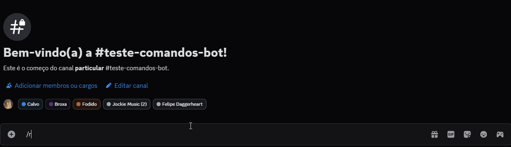

# Bot de Discord para Daggerheart 🗡️❤️


### Um bot completo para Discord feito em discord.js para auxiliar em mesas de RPG, com foco no sistema Daggerheart e com ferramentas de gerenciamento para mestres e jogadores.

## Funcionalidades

-   **/dh**: Rola os dados de dualidade (Esperança e Medo) de Daggerheart, com suporte a modificadores e tratando empates como rolagens críticas.
-   **/rolar**: Um rolador de dados universal que suporta o formato padrão `XdY` (ex: `2d6`, `1d20`) e modificadores. Ideal para rolagens de dano e outros testes.
-   **/fear**: Um rastreador para o nível de "Medo" da mesa. O valor é salvo e persiste mesmo que o bot seja reiniciado.
-   **/ficha**: Um sistema de ficha de personagem simples onde jogadores podem definir e consultar seus status (HP, Shield, Stress, Hope). Mestres podem editar a ficha de outros jogadores.
-   **/inimigo**: Um gerenciador de encontros completo para o Mestre. Permite adicionar, editar, remover e listar inimigos em combate. Cada inimigo recebe um ID único, permitindo nomes duplicados (ex: vários "Goblins"). O sistema de **autocompletar inteligente** facilita a seleção de alvos para edição ou remoção.

## Como Instalar e Rodar

Siga os passos abaixo para hospedar sua própria instância do bot.

1.  **Clone o Repositório**
    ```bash

    git clone https://github.com/lhgomesdev/daggerheart-discord-bot
    cd daggerheart-discord-bot
    ```

2.  **Instale as Dependências**
    É necessário ter o [Node.js](https://nodejs.org/) instalado.
    ```bash
    npm install
    ```

3.  **Configure as Variáveis de Ambiente**
    -   Neste repositório, você encontrará um arquivo chamado `.env.example`. Ele serve como um modelo.
    -   Faça uma cópia deste arquivo e renomeie a cópia para `.env`.
    -   Abra o seu novo arquivo `.env` e preencha as variáveis com suas informações secretas:
        ```
        DISCORD_TOKEN=O_TOKEN_SECRETO_DO_SEU_BOT
        CLIENT_ID=O_ID_DA_APLICAÇÃO_DO_SEU_BOT
        GUILD_ID=O_ID_DO_SEU_SERVIDOR_DE_TESTES
        ```
    -   **Importante:** O arquivo `.gitignore` já está configurado para impedir que seu arquivo `.env` seja enviado para o GitHub, mantendo seu token seguro.

4.  **Registre os Comandos no Discord**
    Execute este comando **uma única vez** (ou sempre que adicionar/modificar um comando) para registrar os slash commands no seu servidor.
    ```bash
    node deploy-commands.js
    ```

5.  **Inicie o Bot**
    ```bash
    node index.js
    ```
    O bot deverá ficar online no seu servidor.

## Exemplos de Uso

#### Rolagens
-   `/dh modificador: 1` - Rola os dados de Daggerheart com +1 de bônus.
-   `/rolar dados: 3d8 modificador: -2` - Rola 3d8 e subtrai 2 do total.

#### Ficha de Personagem
-   `/ficha definir hp: 12 stress: 2` - Define os status da sua ficha.
-   `/ficha ver` - Mostra a sua ficha atual.
-   `/ficha definir hp: 8 usuario: @Amigo` - (Apenas para Mestres) Edita a ficha de outro jogador.

#### Gerenciamento de Jogo (Mestre)
-   `/fear adicionar valor: 1` - Aumenta o Medo da mesa em 1.
-   `/inimigo listar` - Mostra um painel com todos os inimigos ativos.
-   `/inimigo adicionar nome: Bandido hp: 5 stress: 3 difficulty: 12 threshold: 8/14` - Adiciona um inimigo ao combate. O bot informará o ID único dele.
-   `/inimigo editar id: [use-o-autocomplete] hp: 8` - Edita o HP de um inimigo. Comece a digitar o nome e o autocompletar irá sugerir o inimigo certo para selecionar.



## Licença

Distribuído sob a licença MIT — veja [LICENSE.txt](./LICENSE.txt) para mais detalhes.
